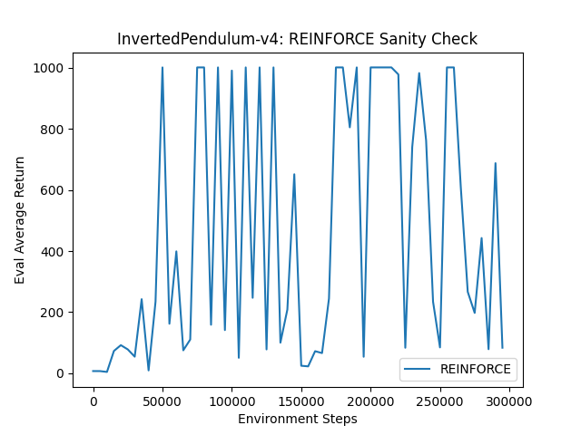
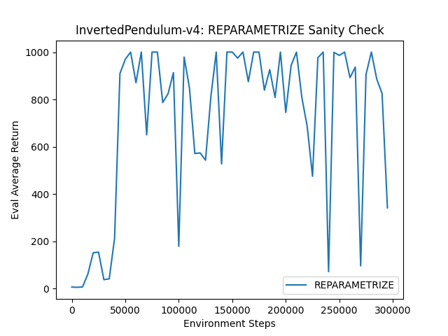
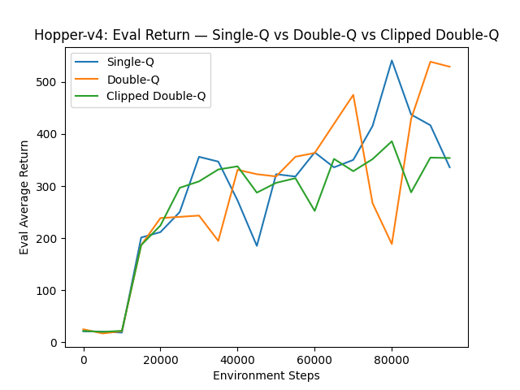
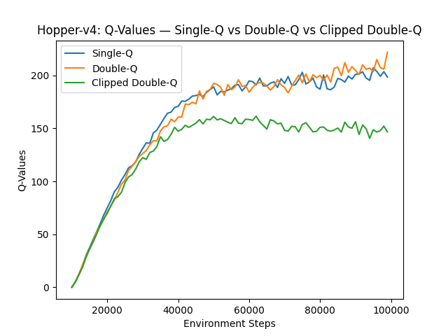
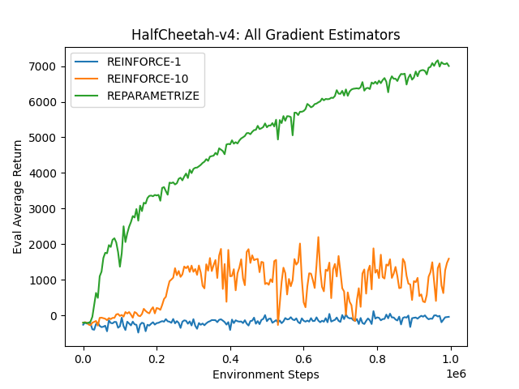
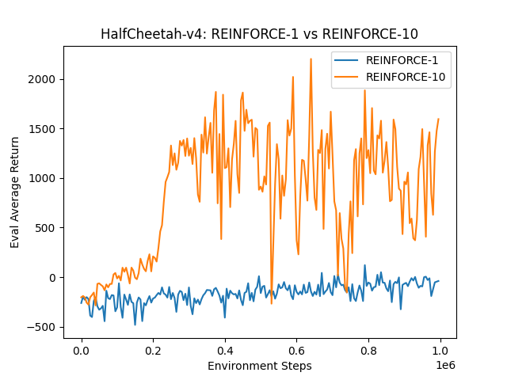

# HW4: Soft Actor-Critic (SAC)

**Course:** CAS4160 — Reinforcement Learning (Yonsei University)  
**Environments:** InvertedPendulum-v4 · Hopper-v4 · HalfCheetah-v4

---

## Overview

This homework implements **Soft Actor-Critic (SAC)**, an off-policy actor-critic algorithm that optimizes the **maximum entropy RL** objective:

$$J(\pi) = \sum_t \mathbb{E}_{(s_t,a_t)\sim\rho_\pi}\bigl[r(s_t,a_t) + \alpha\,\mathcal{H}(\pi(\cdot|s_t))\bigr]$$

Entropy regularization encourages exploration and robustness by incentivizing the policy to remain stochastic.

### Components

- **Actor:** Gaussian policy (neural network outputs mean & log-std); squashed via tanh
- **Critic:** Two Q-networks (clipped double-Q) to reduce overestimation bias
- **Target networks:** Soft (Polyak) updates — $\theta' \leftarrow \tau\theta + (1-\tau)\theta'$
- **Replay buffer:** Off-policy learning from stored transitions

### Gradient Estimators

Two actor gradient estimators are compared:

| Estimator | Method | Variance |
|---|---|---|
| **REINFORCE** | Score-function / log-prob trick | High |
| **Reparameterization** | $a = \mu + \sigma\epsilon$, $\epsilon\sim\mathcal{N}(0,I)$ | Low |

The reparameterization trick enables direct gradient flow through sampled actions, significantly reducing variance.

---

## Results

### InvertedPendulum-v4 — Sanity Check

REINFORCE estimator:



Reparameterization estimator:



---

### Hopper-v4

Evaluation return:



Q-value estimates:



---

### HalfCheetah-v4

All methods (single critic, double critic, clipped Q):



REINFORCE variants comparison:



---

## Project Structure

```
hw4/
├── cas4160/
│   ├── agents/          # SAC agent
│   ├── networks/        # Actor and critic networks
│   ├── infrastructure/  # Replay buffer, logging, utils
│   ├── env_configs/     # Environment configurations
│   └── scripts/
│       └── run_hw4.py   # Entry point
├── images/              # Result plots
├── latex/               # Report (LaTeX source)
├── requirements.txt
└── setup.py
```

---

## Setup

### Option 1: Docker

```bash
docker pull jellyho/cas4160:0307
```

### Option 2: Conda

Install system dependencies (Linux):

```bash
apt-get install -y libosmesa6-dev libgl1-mesa-glx libglfw3 \
    libgl1-mesa-dev libglew-dev patchelf ffmpeg
```

Create environment:

```bash
conda create -n cas4160 python=3.10 -y
conda activate cas4160
pip install swig
pip install -r requirements.txt
pip install -e .
```

---

## Running Experiments

```bash
# InvertedPendulum sanity check
python cas4160/scripts/run_hw4.py \
    --env_name InvertedPendulum-v4 --estimator reparametrize \
    --exp_name sanity_invpendulum_reparametrize

# Hopper
python cas4160/scripts/run_hw4.py \
    --env_name Hopper-v4 --estimator reparametrize \
    --exp_name sac_hopper

# HalfCheetah — all estimators
python cas4160/scripts/run_hw4.py \
    --env_name HalfCheetah-v4 --estimator reinforce \
    --exp_name sac_cheetah_reinforce

python cas4160/scripts/run_hw4.py \
    --env_name HalfCheetah-v4 --estimator reparametrize \
    --exp_name sac_cheetah_reparametrize
```

### Visualize

```bash
tensorboard --logdir data
```

---

## Key Findings

- **Reparameterization** converges faster and more stably than REINFORCE across all environments.
- The **clipped double-Q trick** prevents Q-value overestimation, especially noticeable on HalfCheetah.
- Soft target updates stabilize training by preventing oscillations in the critic targets.
- SAC's entropy bonus provides automatic exploration, enabling it to solve Hopper without manual exploration schedules.
